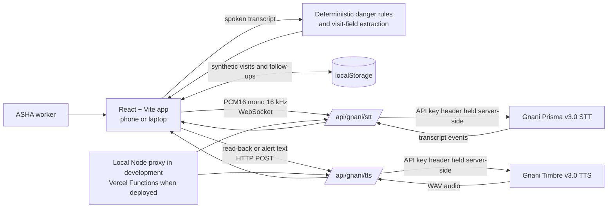

# ASHA SAKHI

Mobile first, voice first synthetic visit register for the Gnani Voice Hackathon PS1. The app opens on Home without login. It uses synthetic records and shows the **Synthetic demo data** marker. See [CHECKLIST.md](CHECKLIST.md) for verified status and evidence.

## Architecture



Visit records, beneficiary data, referrals, and follow-ups in this prototype are synthetic and stored in browser localStorage. Captured microphone audio and TTS request text pass through same-origin server endpoints; the API key is never sent to the browser.

## Run locally

Requirements: Node.js 20+ and npm.

```sh
npm install
npm run dev
```

Gnani speech requires a server-only API key. Put `GNANI_API_KEY_ID` in the ignored `.env.local` file (copy `.env.example` as a starting point); never use a `VITE_` variable or commit the key. `npm run dev` starts the local API proxy and Vite. The proxy keeps the key out of browser code and sends speech requests to Gnani. In Settings, choose **Gnani Prisma v3.0** for microphone transcription; browser microphone permission is required. Timbre v3.0 with the Shivani voice is the read-back default. `GNANI_TTS_MODEL` and `GNANI_TTS_VOICE` can be set in `.env.local` if your account uses another supported combination. If Timbre audio cannot be reached or played, the app falls back to browser speech and labels it accordingly. `GET /api/gnani/status` reports configuration without exposing the key.

Prisma uses the official streaming WebSocket protocol and Timbre uses the official inference API. See [Prisma streaming](https://docs.gnani.ai/api/STT/stt-websocket) and [Timbre inference](https://docs.gnani.ai/api/TTS/tts-inference). The integration has been smoke-tested against Gnani with generated synthetic speech. Browser microphone capture and actual device playback should still be checked on the target laptop/phone.

Open the Vite URL on a phone or set the browser viewport to 390 × 844. At laptop widths (1000 px and above), the app switches to a full-window workspace with a left navigation rail, a two-column dashboard, and larger content areas. The existing phone layout remains active below that breakpoint. App data is stored in localStorage. `npm run build` makes `dist/`; `npm run test` runs Vitest domain tests.

## Demo flows

- Choose BEN-1001 Sunita Patil, tap **Normal visit · Simulated**, and review the five fields. Use **Correct field** and `No, weight is 56 kilo`, or choose **Speak correction (Browser speech)**, then confirm. The app records the correction and creates the 20 November follow-up.
- Choose **Emergency · Simulated**. A deterministic rule shows a referral alert before read-back. **Show nearest PHC** opens the map with the sample facility highlighted; return to the draft and confirm to save the danger flag.
- BEN-1002 is the newborn case. Choose **Newborn concern · Simulated** for NB-01 and NB-03. “No bleeding” stays quiet; “Maybe bleeding” is flagged for review.

All simulated transcripts and browser speech are identified as simulated/browser behavior; neither is Gnani. The browser Speech Synthesis API is used for prototype read-back when available. Browser speech recognition is optional and browser dependent.

## Speech providers

**Gnani Prisma v3.0** is selected by default and the selection is saved on this device. **Simulated** and **Browser speech** remain available as explicit alternatives. Gnani Prisma and Timbre use the server-side proxy when the key is configured. Neither browser speech nor simulated speech is presented as Gnani. `CHECKLIST.md` records the implementation and remaining device-level verification.

## Gnani API platform services used

The app uses two Gnani APIs. `GNANI_API_KEY_ID` is read only by the local Node proxy or Vercel Functions and is sent to Gnani in server-to-server headers. It must not be exposed through a `VITE_` variable or committed.

| Gnani service | Use in ASHA SAKHI | Endpoint and protocol | Request details |
|---|---|---|---|
| **Prisma v3.0 Speech-to-Text** | Live visit voice capture and streaming transcript | [`wss://api.vachana.ai/stt/v3/stream`](https://docs.gnani.ai/api/STT/stt-websocket) · WebSocket | Auth header `x-api-key-id`; model `prisma-v3.0`; `language_code=indic-auto`; `format=codemix`; `x-sample-rate=16000`. The browser captures mono PCM16 audio and streams frames through `/api/gnani/stt`. |
| **Timbre v3.0 Text-to-Speech** | Spoken read-back and localized danger alert | [`POST https://api.vachana.ai/api/v1/tts/inference`](https://docs.gnani.ai/api/TTS/tts-inference) · HTTPS REST | Auth header `X-API-Key-ID`; default voice `Shivani`; UI languages map to `en-IN`, `hi-IN`, and `mr-IN`. Requests ask for mono 48 kHz, 16-bit linear PCM in a WAV container; returned audio is played by the app. |

The current app configuration uses Prisma's automatic Indic-language detection and Timbre's synchronous WAV response. The optional Timbre model and voice are set with server-only `GNANI_TTS_MODEL` and `GNANI_TTS_VOICE` variables. The [Prisma supported-language list](https://docs.gnani.ai/api/STT/languages) describes the available STT language codes.

## Deploy to Vercel

The repo is prepared for Vercel: `vercel.json` builds the Vite app to `dist/`, and `api/gnani/` contains server-side status, Timbre, and Prisma streaming functions. The browser only calls same-origin `/api/gnani/*` routes; the Gnani key stays in server environment variables, and the paid speech endpoints reject cross-origin requests. On Vercel, import this GitHub repository and add `GNANI_API_KEY_ID` under Project Settings → Environment Variables for Preview and Production. Do not prefix it with `VITE_` or place it in Git. Optionally set `GNANI_TTS_MODEL` and `GNANI_TTS_VOICE`; defaults are `timbre-v3.0` and `Shivani`. Redeploy after setting variables. The Prisma WebSocket function is configured for up to five minutes; Vercel WebSocket support is currently public beta and closes a connection at the function duration limit, so keep visits short and reconnect if a session expires. Before sharing a public demo, enable suitable Vercel Firewall rate limits for `/api/gnani/tts` and `/api/gnani/stt` to reduce third-party API abuse. The local `.env.local` is excluded from Git and Vercel uploads.

## Map and scope

Map geometry, household pins, and facility data are synthetic and labelled **Sample geography, not real boundaries**. OpenStreetMap tiles provide visual context; a drawn SVG schematic appears if tiles fail. No worker location is tracked. The prototype makes no claims of government integration, offline speech, or measured accuracy. No diagnosis, medicine, or dosage guidance is provided.

Login, roles, registration, supervisor or national dashboards, learning centre, government integration, PostGIS, Celery, and Redis are out of scope and roadmap only.

## Browser acceptance suite

`npm run e2e` runs the five 390 × 844 Playwright acceptance scenarios in `tests/e2e/acceptance.spec.ts`. Install the browser with `npx playwright install chromium` first. In this environment macOS denies Chromium’s `bootstrap_check_in` call, so execution stops before UI assertions. Domain tests pass; Prisma streaming and Timbre audio were smoke-tested through the running local proxy using generated synthetic speech. See `CHECKLIST.md` for current evidence and limits.
