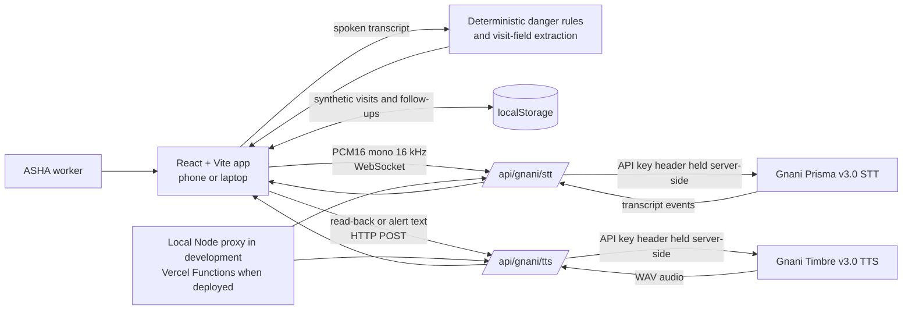

# ASHA SAKHI

Mobile-first, voice-first synthetic visit register for the Gnani Voice Hackathon PS1. Now backed by **Supabase Postgres, Auth, and Row-Level Security (RLS)**, a fast multi-language landing page (`/`), worker authentication & onboarding (`/login`, `/signup`, `/forgot`, `/reset`, `/onboarding`), zero-friction isolated anonymous demo entry (**Try the live demo**), and JWT-protected Gnani Prisma v3.0 & Timbre v3.0 endpoints.

All patient-like data is synthetic and displays the **Synthetic demo data** marker. See:
- [docs/SUPABASE_SETUP.md](docs/SUPABASE_SETUP.md) — numbered dashboard & local CLI setup steps
- [docs/SECURITY.md](docs/SECURITY.md) — threat model, RLS summary, JWT auth, rate limits, CSP, and cleanup
- [docs/DATA_MODEL.md](docs/DATA_MODEL.md) — Postgres tables, ER diagram, audit triggers, and security-definer RPCs
- [docs/PRIVACY.md](docs/PRIVACY.md) — worker account data, retention, deletion, and synthetic data notice
- [CHECKLIST.md](CHECKLIST.md), [MANUAL_TEST.md](MANUAL_TEST.md), and [PHASE_REPORT.md](PHASE_REPORT.md)

## Quick start (fresh clone)

```sh
npm install
# Optional (requires Docker + Supabase CLI for live local Postgres & Mailpit):
supabase start && supabase db reset
npm run dev
```

- Landing page: `http://localhost:5173/` (click **Try the live demo** or **Create worker account**)
- Protected workspace: `http://localhost:5173/app` (redirects to `/login?next=/app` when signed out)
- Auth routes: `/login`, `/signup`, `/forgot`, `/reset`, `/onboarding`, `/privacy`

## Architecture



Visit records, beneficiary data, referrals, and follow-ups in this prototype are synthetic and stored in browser localStorage. Captured microphone audio and TTS request text pass through same-origin server endpoints; the API key is never sent to the browser.

## Run locally

Requirements: Node.js 20+ and npm.

```sh
npm install
npm run dev
```

Gnani speech requires a server-only API key. Put `GNANI_API_KEY_ID` in the ignored `.env.local` file (copy `.env.example` as a starting point); never use a `VITE_` variable or commit the key. `npm run dev` starts the local API proxy (`server/index.mjs` on `127.0.0.1:4174`) and Vite. The proxy keeps the key out of browser code and sends speech requests to Gnani.

In Settings, choose **Gnani Prisma v3.0** for microphone transcription; browser microphone permission is required. Timbre v3.0 with the Shivani voice is the read-back default. `GNANI_TTS_MODEL` and `GNANI_TTS_VOICE` can be set in `.env.local` if your account uses another supported combination. If Gnani Prisma or Timbre cannot be reached, if microphone permission is denied, or if the device is offline, the app switches to a visibly labelled fallback (**Typed entry (Fallback)**, **Browser speech (Fallback)**, or text-only read-back) and never presents fallback output as Gnani.

Health and status endpoints:
- `GET /api/health` — returns `{ status: "ok", service: "asha-sakhi", gnaniConfigured, rateLimitStore, timestamp }` without exposing secrets (`rateLimitStore` reports `"kv"` when shared Upstash/Vercel KV is configured, or `"memory"` otherwise).
- `GET /api/gnani/status` — reports whether Gnani is configured plus configured model/voice names without exposing the key.

Open the Vite URL on a phone or set the browser viewport to 390 × 844. At laptop widths (1000 px and above), the app switches to a full-window workspace with a left navigation rail, a two-column dashboard, and larger content areas. The existing phone layout remains active below that breakpoint. App data is stored in localStorage. `npm run build` makes `dist/`; `npm run test` runs Vitest domain, i18n, and server security tests.

## Demo flows

- Choose BEN-1001 Sunita Patil, tap **Normal visit · Simulated**, and review the five fields. Use **Correct field** and `No, weight is 56 kilo`, or choose **Speak correction (Browser speech)**, then confirm. The app records the correction and creates the 20 November follow-up.
- Choose **Emergency · Simulated**. A deterministic rule shows a referral alert before read-back. **Show nearest PHC** opens the map with the sample facility highlighted; return to the draft and confirm to save the danger flag.
- BEN-1002 is the newborn case. Choose **Newborn concern · Simulated** for NB-01 and NB-03. “No bleeding” and “bleeding nahi” stay quiet; “Maybe bleeding” is flagged for review.
- **Phase 2 features (labelled `Phase 2`):** Offline IndexedDB draft queue (`pending`/`syncing`/`synced`/`failed`, per-visit idempotency key, pluggable `SyncTransport` interface for Phase 4; voice capture explicitly requires connectivity and never claims offline speech), UTF-8 BOM CSV export (Visits, Follow-ups, Referrals), **Tomorrow’s voice reminder** (queued through Timbre with labelled fallback), same-day duplicate visit warning with audit-logged override reason, installable PWA (`manifest.webmanifest` + `sw.js` + splash), text size controls, and an **About & limitations** screen in Settings.

All simulated transcripts, typed fallbacks, and browser speech are visibly identified as simulated/fallback behavior; none is presented as Gnani.

## Speech providers

**Gnani Prisma v3.0** is selected by default and the selection is saved on this device. **Simulated** and **Browser speech** remain available as explicit alternatives. Gnani Prisma and Timbre use the server-side proxy when the key is configured. Neither browser speech, typed fallback, nor simulated speech is presented as Gnani. `CHECKLIST.md` records the implementation and remaining device-level verification.

## Gnani API platform services used

The app uses two Gnani APIs. `GNANI_API_KEY_ID` is read only by the local Node proxy or Vercel Functions and is sent to Gnani in server-to-server headers. It must not be exposed through a `VITE_` variable or committed.

| Gnani service | Use in ASHA SAKHI | Endpoint and protocol | Request details |
|---|---|---|---|
| **Prisma v3.0 Speech-to-Text** | Live visit voice capture and streaming transcript | [`wss://api.vachana.ai/stt/v3/stream`](https://docs.gnani.ai/api/STT/stt-websocket) · WebSocket | Auth header `x-api-key-id`; `model=prisma-v3.0`; `language_code` mapped per selected UI language (`indic-auto` for EN/code-mix, `hi-IN` for HI, `mr-IN` for MR — single locale required on `/stt/v3/stream`); `format=codemix`; `x-sample-rate=16000`; `x-vad-threshold=0.5`; `x-min-silence-ms=600`; `x-idle-timeout-sec=120`. The browser captures mono 16 kHz PCM16 with echo cancellation, noise suppression, and auto gain control, streaming exact 1,024-byte (512-sample / 32 ms) frames through `/api/gnani/stt` with heartbeat and exponential-backoff reconnect. |
| **Timbre v3.0 Text-to-Speech** | Spoken read-back and instant cached danger alerts | [`POST https://api.vachana.ai/api/v1/tts/inference`](https://docs.gnani.ai/api/TTS/tts-inference) · HTTPS REST | Auth header `X-API-Key-ID`; `model=timbre-v3.0`; universal multilingual voice `Shivani` (overridable via `GNANI_TTS_VOICE` or `GNANI_TTS_VOICE_EN/HI/MR`); languages `en-IN`, `hi-IN`, `mr-IN`; `speed` `0.95` (read-back) / `1.0` (alert); mono 48 kHz 16-bit `linear_pcm` WAV for live synthesis (24 kHz for static pre-generated read-back assets). Requests pass through a server-side **concurrency-1 queue** (`server/timbreQueue.mjs`) with 429 exponential-backoff retry and visible labelled fallback on retry exhaustion. **Read-back audio for scripted demo values is pre-generated Timbre audio** (`public/audio/readback/`, loaded lazily on demand for the active language only when the record matches the template exactly); **live or custom visit values use live Timbre synthesis** with in-memory/server LRU caching. Danger alert WAVs (`public/audio/alert-{en,hi,mr}.wav`) are warmed for the active language only. |

## How audio streaming works on Vercel (and locally)

The architecture uses **bidirectional WebSocket streaming** (not chunked/batched HTTP polling):

1. **In local development (`npm run dev`) and standalone Node (`npm run start:prod`):** `server/index.mjs` runs a Node.js HTTP server with `ws` (`WebSocketServer`). Vite proxies `/api/*` (with `ws: true`) to `127.0.0.1:4174`. The browser opens `ws://<host>/api/gnani/stt`, streams 512-sample mono PCM16 (16 kHz) binary frames, and `server/index.mjs` opens an authenticated upstream WebSocket to `wss://api.vachana.ai/stt/v3/stream`.
2. **On Vercel (`api/gnani/stt.js`):** Standard legacy serverless functions cannot hold WebSocket connections open. `api/gnani/stt.js` exports a Node.js `http.Server` wrapped with `ws` (`WebSocketServer`), which relies on **Vercel Functions native WebSocket support powered by Fluid Compute**. When a browser connects to `wss://<deployment>/api/gnani/stt`, Vercel upgrades the HTTP request and pins that WebSocket connection to an active Fluid Compute function instance for the session lifetime, proxying binary PCM16 frames to Gnani Prisma v3.0 and returning transcript events.
3. **Hard limits and operational requirements on Vercel:**
   - **Fluid Compute must be enabled** on the Vercel project (otherwise Vercel will not keep WebSocket connections open).
   - **Duration limit:** `vercel.json` sets `maxDuration: 300` (5 minutes) for `api/gnani/stt.js` and `60` seconds for `api/gnani/tts.js`, subject to the Vercel plan's maximum duration cap. The proxy itself also enforces a 180-second session cap and a 6 MB cumulative audio cap (~3 minutes of 16 kHz mono PCM16) per WebSocket session, and Gnani applies a 120-second idle timeout (`x-idle-timeout-sec`). Keep visits concise; if a session reaches the limit, start a new capture or use the typed fallback.
   - **Fallback if Fluid Compute WebSockets are unavailable on the target Vercel plan:** Either host `server/index.mjs` on a persistent Node container (Fly.io, Render, Cloud Run) or switch STT to a chunked/batched REST design (not done here so the documented WebSocket architecture stays intact).

## Server security and operations

All `/api/*` endpoints enforce:
- **Method restrictions:** `GET`/`HEAD` on `/api/health`; `GET`/`OPTIONS` on `/api/gnani/status`; `POST`/`OPTIONS` on `/api/gnani/tts`; WebSocket upgrade only on `/api/gnani/stt` (`426` on plain HTTP `GET`, `405` on other methods).
- **Same-origin / CORS enforcement:** `/api/gnani/tts` and `/api/gnani/stt` require a matching same-origin `Origin` header and reject cross-origin requests (`403` / WS `1008`).
- **Input and size limits:** `/api/gnani/tts` requires `Content-Type: application/json`, caps request bodies at 16 KB (`413`), text at 1–4,000 chars (`400`), languages to `en`/`hi`/`mr` (`400`), and upstream audio at 10 MB. `/api/gnani/stt` caps individual frames at 64 KB, total audio per session at 6 MB (`1009`), session duration at 180 s, and control frames to `{ "type": "commit" }` (`1008`).
- **Rate limiting:** Supports a **shared cross-instance Redis/KV rate limiter** via `KV_REST_API_URL` + `KV_REST_API_TOKEN` (Vercel KV / Upstash REST) with automatic fallback to per-instance in-memory limiting. Defaults are tuned so normal judge testing and 3-minute live demos on shared Wi-Fi are never blocked: **60 requests/min** on `/api/gnani/tts` and **20 new sessions/min (max 4 concurrent)** per IP on `/api/gnani/stt` (`429` + `Retry-After`). If KV is not configured on Vercel, also configure matching **Vercel Firewall rate-limiting rules** (`60 req / 60s` on `/api/gnani/tts`, `20 req / 60s` on `/api/gnani/stt`).
- **Operational instrumentation & safe logging:** Server routes emit single-line JSON logs containing only `event`, `route`, `status`, `errorCode`, `latencyMs`, and `language` — never API keys, audio bytes, or transcripts. Settings includes a collapsible **Voice diagnostics** panel (also toggleable via `?debug=1`) showing active provider, STT connection state, time to first partial/final, Timbre latency/cache hit, reconnect count, and last error code (no transcripts or keys).

## Gnani evaluation corpus and metrics

- Read-aloud corpus (200 utterances: 40 `dev` + 40 `test_v1` seen regression + **120 frozen unseen `test_v2` human held-out** across Marathi, Hindi, English, and code-mix) and exact human recording instructions: [tests/corpus/SCRIPT.md](tests/corpus/SCRIPT.md), [tests/corpus/manifest.json](tests/corpus/manifest.json), [tests/corpus/test_split_frozen.json](tests/corpus/test_split_frozen.json) (`test_v1`, seen regression), and [tests/corpus/test_v2_frozen.json](tests/corpus/test_v2_frozen.json) (`test_v2`, frozen unseen human held-out).
- Candidate Devanagari-transliterated English danger variants awaiting native-speaker review (`pending_review`): [rules/variants_candidates.md](rules/variants_candidates.md).
- Exact Gnani parameter citations, live API observations (`multi_lang_codes`), and open questions for Gnani staff: [docs/GNANI_NOTES.md](docs/GNANI_NOTES.md).
- Run live evaluation locally against human recordings in `tests/corpus/audio/*.wav` (refuses to run on CI; refuses synthetic generation on `test_v2`):
  ```sh
  npm run gnani:eval -- --split test_v2
  npm run metrics
  ```
- Regenerate pre-cached Timbre alert WAVs (`public/audio/alert-{en,hi,mr}.wav`) or scripted demo read-back WAVs (`public/audio/readback/*.wav`):
  ```sh
  npm run gnani:alert-audio
  npm run gnani:readback-audio
  ```
- Offline metrics report: [docs/METRICS.md](docs/METRICS.md) (headline metrics come **exclusively** from `test_v2` human recordings; until human recordings exist, Section 1 reports `No human-speech result yet.`).

## Deploy to Vercel

1. Import this repository on Vercel (`vercel.json` builds Vite to `dist/` and deploys `api/health.js` and `api/gnani/*.js`).
2. Add `GNANI_API_KEY_ID` under **Project Settings → Environment Variables** for Preview and Production. Never prefix it with `VITE_` or commit it to Git.
3. Optionally set `GNANI_TTS_MODEL` (`timbre-v3.0`) and `GNANI_TTS_VOICE` (`Shivani`).
4. Ensure **Fluid Compute** is enabled on the Vercel project for `/api/gnani/stt` WebSockets, and configure Vercel Firewall rate limits on `/api/gnani/*`.
5. Redeploy and verify `GET /api/health` returns `{"status":"ok","gnaniConfigured":true}`.

The local `.env.local` is excluded from Git (`.gitignore`) and Vercel uploads (`.vercelignore`).

## Map and scope

Map geometry, household pins, and facility data are synthetic and labelled **Sample geography, not real boundaries**. OpenStreetMap tiles provide visual context; a drawn SVG schematic appears behind the interactive markers if tiles fail. No worker location is tracked. The prototype makes no claims of government integration, offline speech, or measured accuracy. No diagnosis, medicine, or dosage guidance is provided.

Government integration, real patient PHI storage, PostGIS, Celery, and national dashboards remain out of scope.

## Automated tests and CI

- **Unit, i18n, and server security tests (Vitest):**
  ```sh
  npm run test
  ```
- **Browser acceptance and verification tests (Playwright, 390 × 844 viewport):**
  ```sh
  npx playwright install chromium
  npm run e2e
  ```
  `tests/e2e/acceptance.spec.ts` runs the five core acceptance scenarios; `tests/e2e/verification.spec.ts` verifies P0 voice/fallback/TTS/corrections/alert checks, P1 history/visit-types/follow-up tabs/referrals, and Map hierarchy/pins/stats/coverage/emergency markers.
  - **macOS sandbox note:** Running Playwright inside a restricted macOS sandbox (`sandbox-exec`) blocks Chromium's `bootstrap_check_in` Mach call (`Permission denied (1100)`). Run `npm run e2e` in a standard unsandboxed terminal session on macOS, or via GitHub Actions (`.github/workflows/ci.yml`), which installs Chromium and runs Vitest, production build, bundle secret check, Playwright, and `gitleaks`.
  - Automated E2E tests use simulated/typed transcripts and synthetic Web Audio streams where a physical device microphone cannot be automated; see [MANUAL_TEST.md](MANUAL_TEST.md) for real-phone checks.
