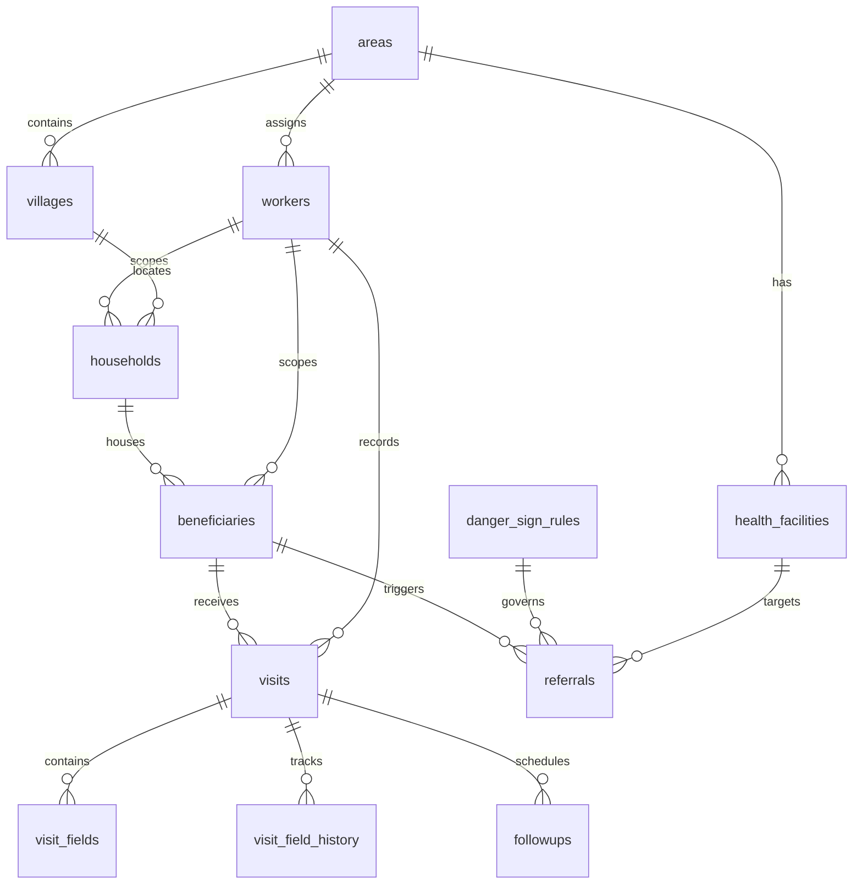

# ASHA SAKHI Data Model & Audit Design

All tables live in `public`, use UTC `timestamptz` timestamps, enforce foreign keys and indexes, and mark patient-like rows with `synthetic boolean not null default true`. **No raw audio is ever stored.**

## 1. Entity Relationship Diagram

## 2. Table Summary & RLS Matrix

| Table | `synthetic` col | Worker Access | Supervisor Access | Client Writes |
|---|---|---|---|---|
| `areas` | Yes | `SELECT` | `SELECT` | None |
| `villages` | Yes | `SELECT` | `SELECT` | None |
| `health_facilities` | Yes | `SELECT` | `SELECT` | None |
| `danger_sign_rules` | N/A (MoHFW ref) | `SELECT` | `SELECT` | None |
| `workers` | N/A | Own row (`role` locked to `worker`) | Own row (`role` immutable) | Own profile only |
| `households` | Yes (`default true`) | Own `worker_id` & `area_id` (`SELECT`) | None | Via `seed_demo_workspace()` |
| `beneficiaries` | Yes (`default true`) | Own `worker_id` & `area_id` (`SELECT`) | None | Via `seed_demo_workspace()` only |
| `visits` | Yes (`default true`) | Own `worker_id` & `area_id` | **None** (counts via RPC only) | Via `confirm_visit()` RPC |
| `visit_fields` | Yes (`default true`) | Owned visits only | **None** | Via `confirm_visit()` RPC |
| `visit_field_history` | Yes (`default true`) | Owned visits only | **None** | Via `confirm_visit()` RPC |
| `followups` | Yes (`default true`) | Own `worker_id` & `area_id` | **None** (counts via RPC only) | Via `confirm_visit()` + status update |
| `referrals` | Yes (`default true`) | Own `worker_id` & `area_id` | Area referrals (`SELECT` & review `UPDATE`) | Via `create_referral()` RPC only |
| `audit_logs` | N/A | Own `actor_id` (`SELECT` only) | Own `actor_id` (`SELECT` only) | **DB triggers only** |

## 3. Audit Design

- `public.write_audit_log()` (`SECURITY DEFINER`, `SET search_path = public, pg_temp`) fires `AFTER INSERT OR UPDATE OR DELETE` on `workers`, `households`, `beneficiaries`, `visits`, `visit_fields`, `visit_field_history`, `followups`, and `referrals`.
- Each entry captures `actor_id` (`auth.uid()`), `table_name`, `row_id`, `action`, `before_data` (JSONB), `after_data` (JSONB), `request_id`, and UTC `occurred_at`.
- Because `authenticated` and `anon` have no `INSERT`, `UPDATE`, or `DELETE` privileges on `audit_logs`, clients cannot bypass or forge audit records.

## 4. Security-Definer RPCs

All RPCs set `SET search_path = public, pg_temp` (or `public, auth, pg_temp` where touching `auth.users`) and grant execute only to `authenticated`:

1. `confirm_visit(...)` — enforces `p_confirmed = true`, deduplicates by `idempotency_key`, writes `visits`, `visit_fields`, `visit_field_history`, links `referral_id`, and creates a `followups` row.
2. `create_referral(...)` — validates `rule_id` against active `danger_sign_rules`, enforces `beneficiary.kind = ANY(rule.applies_to)`, sets authoritative `rule_version`, truncates excerpt to 240 chars, and assigns the area's sample PHC.
3. `seed_demo_workspace(...)` — creates/updates the caller's `workers` profile (`role = 'worker'`) and clones the five synthetic beneficiaries (`BEN-1001`–`BEN-1005`) and households strictly under `worker_id = auth.uid()`.
4. `supervisor_area_summary()` — checks `role = 'supervisor'` and returns aggregated counts only for the supervisor's `area_id`.
5. `dashboard_csv_summary()` — returns scoped counts (aggregates-only for supervisors).
6. `delete_my_account()` — deletes the caller's `workers` row (cascading all owned synthetic records) and deletes their `auth.users` row.
7. `cleanup_expired_anonymous_users()` — scheduled daily via `pg_cron` (`0 3 * * *`) to remove anonymous accounts older than 7 days.
